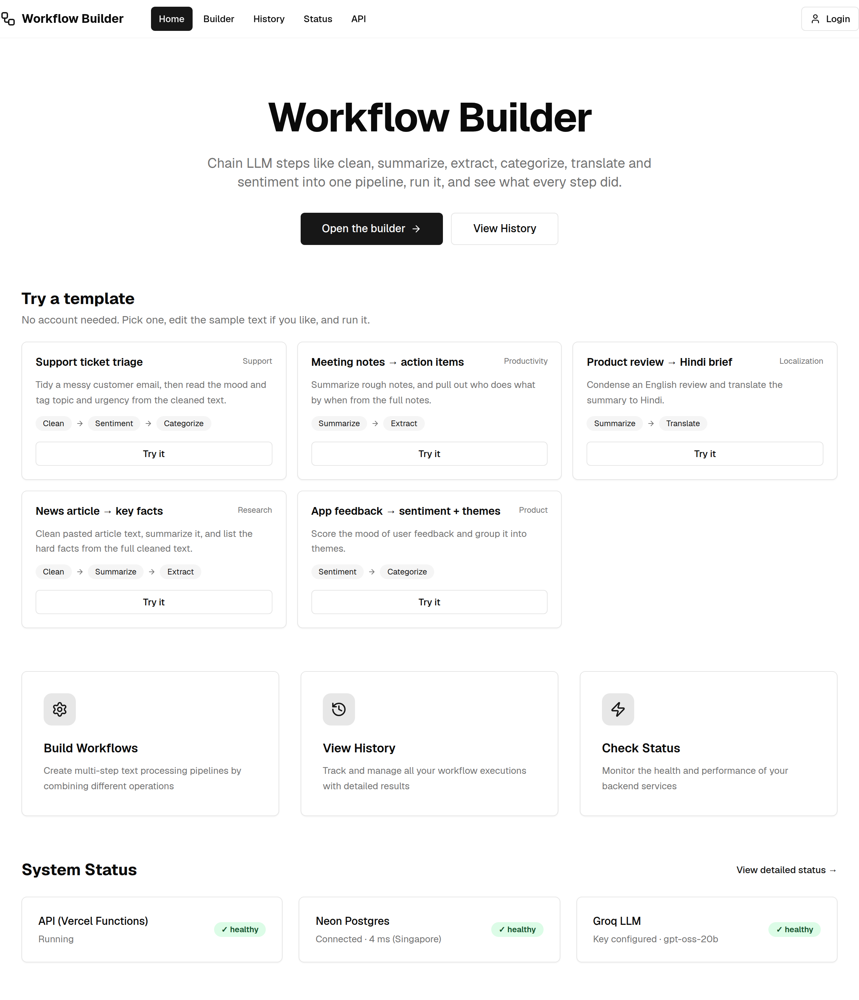
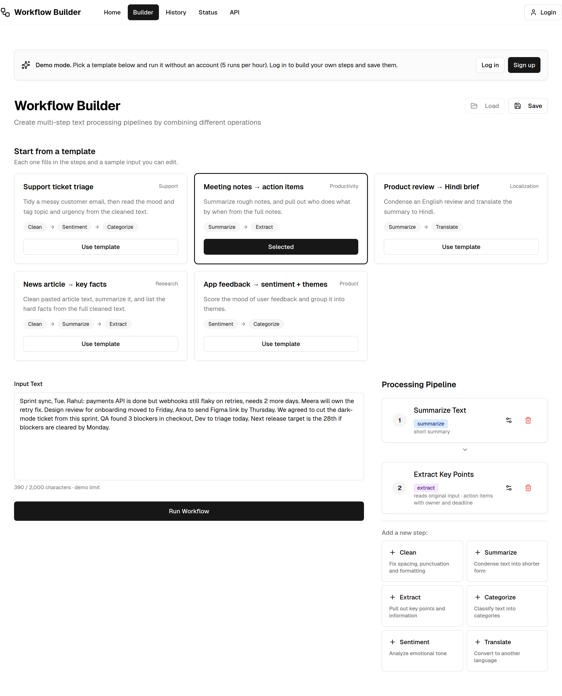
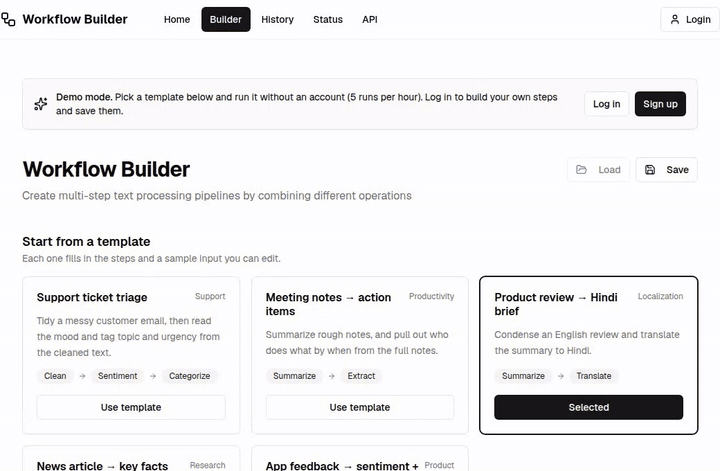
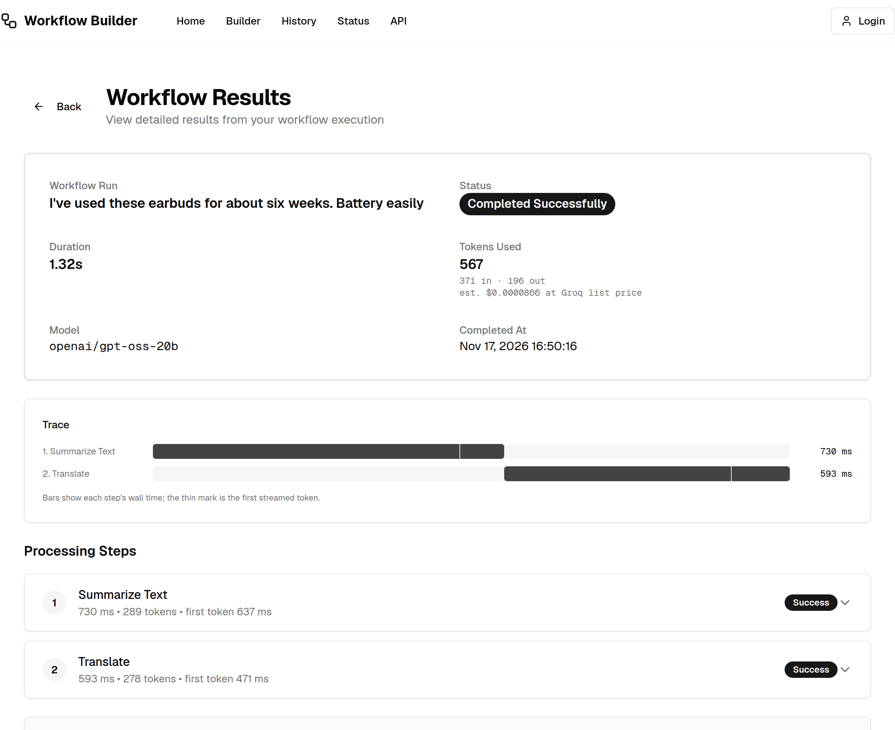
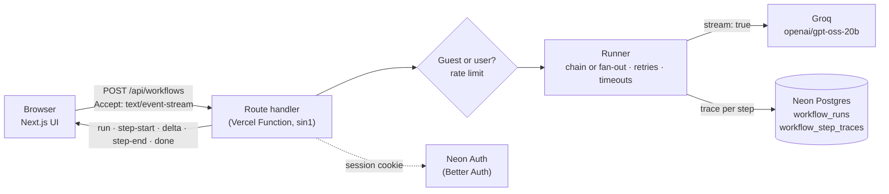

# Workflow Builder

Chain LLM text steps — clean, summarize, extract, categorize, translate, sentiment — into one pipeline and watch each step stream in. Every step is traced (latency, time to first token, tokens, retries, estimated cost), retried when the provider fails, and checked by an eval harness.

**Live:** [workflow-builder-umber.vercel.app](https://workflow-builder-umber.vercel.app)

Templates run without an account (5 runs per hour per visitor). Sign up to build your own steps, save workflows, and keep a run history. API reference: [/docs/api](https://workflow-builder-umber.vercel.app/docs/api) · spec: [/api/openapi.json](https://workflow-builder-umber.vercel.app/api/openapi.json).









## Features

- Six text steps, chained by default. A step can instead read the original input or any earlier step, so one cleaned text can fan out to sentiment and categorization.
- Seeded templates with sample text. Guests run those steps from the database, not from the browser.
- Live output over Server-Sent Events, then a per-step trace: latency, time to first token, tokens, model, attempts, and estimated cost.
- Retries with exponential backoff and a per-attempt timeout. A `retry` event clears the partial output and says why.
- Saved workflows and run history for signed-in users. Demo runs stay readable by link.
- OpenAPI 3.1 spec, rendered at `/docs/api`. A test fails if a route handler is missing from the spec.
- An eval harness (`pnpm eval`) with rubric checks and an LLM judge. CI runs the rubric unit tests, not the live eval.

## Architecture



1. The builder posts the steps (or a template slug) with `Accept: text/event-stream`.
2. The route checks the request, the session and the rate limit, creates a `workflow_runs` row, then answers with a Server-Sent Events stream. Errors that happen before the run starts (bad input, missing key, limit hit) come back as normal JSON with a 4xx/5xx status.
3. The runner calls Groq with `stream: true` for each step and forwards every chunk as a `delta` event. By default a step reads the previous step's output; a step can instead read the original input or any earlier step (`source`). Each attempt has a timeout, failed attempts are retried (see below), and the run stops at the first step that still fails.
4. When a step finishes, its trace is written to `workflow_step_traces`. When the run finishes, the full result and token totals go into `workflow_runs`.

Clients that don't ask for a stream get the whole result as one JSON response.

## Stack

Next.js 16 (App Router, route handlers) · React 19 · TypeScript · Tailwind · shadcn/ui · zustand · zod · Neon Postgres (`@neondatabase/serverless`) · Neon Auth · Groq · Vitest · Vercel (functions pinned to `sin1`, next to the database)

## Quickstart

Requirements: Node 22+, pnpm 10, a Neon database (the Vercel Neon integration works) with Neon Auth enabled, and a Groq API key.

```bash
pnpm install
vercel env pull .env.local    # or copy .env.example to .env.local and fill it in
pnpm db:migrate               # creates tables and seeds templates; safe to re-run
pnpm dev
```

| Variable | Notes |
| --- | --- |
| `DATABASE_URL`, `DATABASE_URL_UNPOOLED` | Neon connection strings |
| `NEON_AUTH_BASE_URL` | From Neon Auth |
| `NEON_AUTH_COOKIE_SECRET` | Any random string of 32+ characters |
| `GROQ_API_KEY` | console.groq.com. Without it the app still loads and runs show an "AI key needed" notice |
| `GROQ_MODEL` | Optional. Defaults to `openai/gpt-oss-20b` |

For production, add your domain under Neon Auth → Configuration → Domains, or sign-in requests are rejected with `INVALID_ORIGIN`.

## Design decisions

**Retries and timeouts.** Each step runs under a retry policy ([lib/server/retry.ts](lib/server/retry.ts)), configurable per step in the builder's Advanced section or the API (`config.retries` 0–3, `config.timeoutMs` 2–30 s):

- Every attempt gets its own `AbortController` deadline (default 20 s). A hung stream is cut off instead of holding the function open.
- 429, 408, 409, 5xx, timeouts and dropped connections are retried (default 2 retries). Other 4xx errors are not.
- Backoff is exponential with jitter (400 ms base, 4 s cap). A `Retry-After` header wins over the computed delay; if it asks for more than twice the cap (a daily token quota, for example), the step fails at once with a readable message instead of burning retries.
- The whole run has a 100 s budget inside the route's 120 s `maxDuration`, so retries cannot push a run past the function limit.
- The Groq SDK's own retries are off (`maxRetries: 0`), so every attempt is visible: the stream sends a `retry` event, and `attempts` is stored on the step trace.

**Tracing, in-house.** No external service or account. `latency_ms` is wall time on the server, `ttft_ms` is time to the first streamed token, `provider_ms` is Groq's own generation time, and token counts come from the usage block on the final stream chunk. `cost_usd` is an estimate at Groq list price ($0.075 / $0.30 per 1M input / output tokens for gpt-oss-20b), shown with 3 significant digits so a fraction of a cent stays readable. The run page draws a waterfall of step timings with a first-token mark on each bar. `/status` shows 24-hour medians for step latency and first token, plus total tokens.

**Fan-out.** Early templates fed each step the previous step's output, so the meeting template's action items were extracted from the summary (and lost owners), and the feedback categorizer categorized the sentiment report. Steps can now set `source` to the original input or an earlier step. Extraction and categorization read the full text.

**Evals.** `pnpm eval` ([eval/](eval/)) runs 15 fixed cases (each template's sample plus 2 held-out inputs per template) through the real runner against Groq, then scores them two ways:

- **Rubric checks** ([eval/rubric.ts](eval/rubric.ts), unit-tested): format checks per step type (sentence limit and "shorter than the input" for summaries, bullets for extraction, one `Category: value` line per category, a sentiment label and confidence, ≥70% Devanagari letters for Hindi) plus facts each case must keep (owners, numbers, names).
- **LLM judge**: `openai/gpt-oss-120b` grades faithfulness, completeness and instruction following from 1 to 5 against the actual step instructions, and lists unsupported claims, as JSON.

The first run found the problems above. The fixes were tighter prompts (keep names and numbers, never longer than the text, "not stated" instead of a guessed deadline) and the `source` option. Same 15 cases, same rubric and judge, one run each on 17 Nov 2026:

| | v1 prompts, chained templates | v2 prompts, fan-out templates |
| --- | --- | --- |
| Rubric checks passed | 120/129 (93.0%) | **126/129 (97.7%)** |
| Cases passing every check | 7/15 | **12/15** |
| Judge faithfulness / completeness / instructions | 4.73 / 4.60 / 4.40 | **4.80 / 4.93 / 4.47** |
| Cases with an unsupported claim (judge) | 3/15 | **1/15** |
| Run latency p50 / p95 | 1025 / 1923 ms | 888 / 1453 ms |
| Mean cost per run | $0.000103 | $0.000116 |

Full tables: [eval/results.md](eval/results.md) (v2) and [eval/history/v1-prompts.md](eval/history/v1-prompts.md). An earlier v1 run with a judge that could not see the step instructions scored 119/129 on the rubric, so expect a point or two of run-to-run noise. Remaining failures: summaries of all three meeting notes still come out a little longer than the notes (303–417 vs 259–390 characters), and the judge flagged one inferred deadline in meeting-infra. Fifteen synthetic cases are a regression check, not a benchmark. The eval needs a Groq key and spends tokens, so CI runs the rubric and case-integrity unit tests, not the live eval.

## Limitations

- Guests can only run seeded templates, input is capped at 2,000 characters, and the limit is 5 runs per hour. The limit is a salted hash of the IP; raw IPs are not stored.
- Signed-in users get 30 runs per hour, 8,000 characters, and at most 8 steps. Counts come from `workflow_runs`, so they hold across serverless instances without Redis.
- A run stops at the first step that still fails after retries. There is no partial-success mode that continues the chain.
- Cost is an estimate at Groq's published list price for `openai/gpt-oss-20b`, not an invoice. A different `GROQ_MODEL` is still priced with that rate.
- The eval is 15 synthetic cases. It is a regression check, not a leaderboard.
- History is per account. A guest can open a demo run by its link. `/history` asks them to log in.
- The app is one Vercel region (`sin1`) beside the Neon database. There is no queue or multi-region failover.

## API

| Route | What it does |
| --- | --- |
| `POST /api/workflows` | Run steps (signed in) or a template (anyone). SSE when `Accept: text/event-stream` |
| `GET /api/workflows` · `DELETE /api/workflows/clear` | Your run history |
| `GET /api/workflows/:id` | One run with its step traces (yours, or any demo run) |
| `GET/POST /api/saved-workflows` · `DELETE /api/saved-workflows/:id` | Saved workflows (signed in) |
| `GET /api/templates` | Public templates |
| `GET /api/health` | Database ping, AI key check, run and trace stats |
| `GET /api/openapi.json` | OpenAPI 3.1 spec; rendered at `/docs/api` |
| `/api/auth/*` | Neon Auth |

The spec ([lib/openapi.ts](lib/openapi.ts)) documents request and response schemas, SSE events, error codes and session security. A test walks `app/api/**/route.ts` and fails if any exported handler is missing from the spec or the spec lists one that doesn't exist, and CI lints it with Redocly.

## Tests and CI

```bash
pnpm test            # Vitest: runner, retries, Groq streaming, SSE parser, limits, API routes, OpenAPI coverage, eval rubric
pnpm typecheck
pnpm openapi:lint    # Redocly lint of the generated spec
GROQ_API_KEY=... pnpm eval   # live eval, writes eval/results.{json,md}
```

The API route tests use a fake SQL client and a mocked Groq call. They cover validation, demo and user limits, the SSE event order, per-step trace writes and run-by-id access. GitHub Actions (`.github/workflows/ci.yml`) runs the typecheck, tests, OpenAPI lint and a production build on every push and pull request.

## History

The first version used Supabase with an Express API on Render. In November 2026 the Supabase project was gone, so the data and auth moved to Neon and the API moved into Next.js route handlers. The old Express code has been removed; it's still in the git history.
