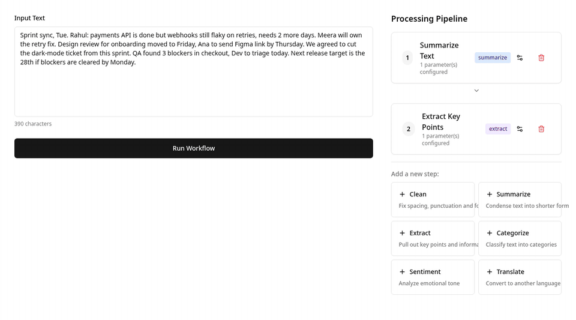
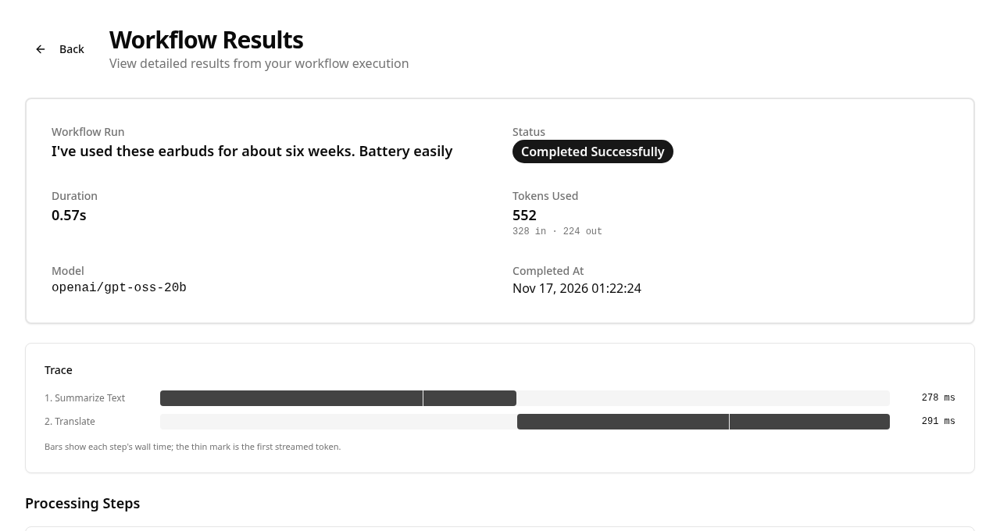

# Workflow Builder

Chain LLM text steps (clean, summarize, extract, categorize, translate, sentiment) into one pipeline and watch each step's output stream in as it runs. Every step is traced: latency, time to first token, tokens and model are shown in the run view and stored in Postgres.

**Live:** https://workflow-builder-umber.vercel.app. Templates run without an account (5 runs per hour per visitor). Sign up to build your own steps, save workflows and keep a run history.



## Architecture


1. The builder posts the steps (or a template slug) with `Accept: text/event-stream`.
2. The route checks the request, the session and the rate limit, creates a `workflow_runs` row, then answers with a Server-Sent Events stream. Errors that happen before the run starts (bad input, missing key, limit hit) come back as normal JSON with a 4xx/5xx status.
3. The runner calls Groq with `stream: true` for each step and forwards every chunk as a `delta` event. A step's output becomes the next step's input; the run stops at the first failing step.
4. When a step finishes, its trace is written to `workflow_step_traces`. When the run finishes, the full result and token totals go into `workflow_runs`.

Clients that don't ask for a stream get the whole result as one JSON response.

## Tracing

Built in-house, with no external service or account:

| Field | Meaning |
| --- | --- |
| `latency_ms` | Wall time of the step, measured on the server |
| `ttft_ms` | Time to the first streamed token |
| `provider_ms` | Generation time reported by Groq |
| `input_tokens` / `output_tokens` / `reasoning_tokens` | From the usage block on Groq's final stream chunk |
| `model` | The model that answered |

The run page draws a waterfall of step timings with a first-token mark on each bar. `/status` shows 24-hour medians for step latency and first token, plus total tokens.



## Demo mode and limits

- Guests can only run seeded templates. The steps are read from the database, never taken from the client, and input is capped at 2,000 characters.
- Guests get 5 runs per hour, keyed by a salted hash of the IP, so raw IPs are never stored. Signed-in users get 30 runs per hour.
- Limits are counted from `workflow_runs`, so they hold across serverless instances without Redis.

## API

| Route | What it does |
| --- | --- |
| `POST /api/workflows` | Run steps (signed in) or a template (anyone). SSE when `Accept: text/event-stream` |
| `GET /api/workflows` · `DELETE /api/workflows/clear` | Your run history |
| `GET /api/workflows/:id` | One run with its step traces (yours, or any demo run) |
| `GET/POST /api/saved-workflows` · `DELETE /api/saved-workflows/:id` | Saved workflows (signed in) |
| `GET /api/templates` | Public templates |
| `GET /api/health` | Database ping, AI key check, run and trace stats |
| `/api/auth/*` | Neon Auth |

## Setup

Requirements: Node 22+, pnpm 10, a Neon database (the Vercel Neon integration works) with Neon Auth enabled, and a Groq API key.

```bash
pnpm install
vercel env pull .env.local    # or copy .env.example to .env.local and fill it in
pnpm db:migrate               # creates tables and seeds templates; safe to re-run
pnpm dev
```

| Variable | Notes |
| --- | --- |
| `DATABASE_URL`, `DATABASE_URL_UNPOOLED` | Neon connection strings |
| `NEON_AUTH_BASE_URL` | From Neon Auth |
| `NEON_AUTH_COOKIE_SECRET` | Any random string of 32+ characters |
| `GROQ_API_KEY` | console.groq.com. Without it the app still loads and runs show an "AI key needed" notice |
| `GROQ_MODEL` | Optional. Defaults to `openai/gpt-oss-20b` |

For production, add your domain under Neon Auth → Configuration → Domains, or sign-in requests are rejected with `INVALID_ORIGIN`.

## Tests and CI

```bash
pnpm test        # Vitest: runner, Groq streaming and usage parsing, SSE parser, rate limits, API routes
pnpm typecheck
```

The API route tests use a fake SQL client and a mocked Groq call. They cover validation, demo and user limits, the SSE event order, per-step trace writes and run-by-id access. GitHub Actions (`.github/workflows/ci.yml`) runs the typecheck, tests and a production build on every push and pull request.

## Stack

Next.js 16 (App Router, route handlers) · React 19 · TypeScript · Tailwind · shadcn/ui · zustand · zod · Neon Postgres (`@neondatabase/serverless`) · Neon Auth · Groq · Vitest · Vercel

## History

The first version used Supabase with an Express API on Render. In November 2026 the Supabase project was gone, so the data and auth moved to Neon and the API moved into Next.js route handlers. The old Express code has been removed; it's still in the git history.
